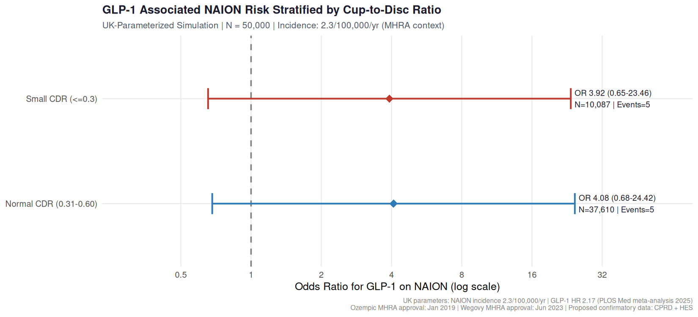
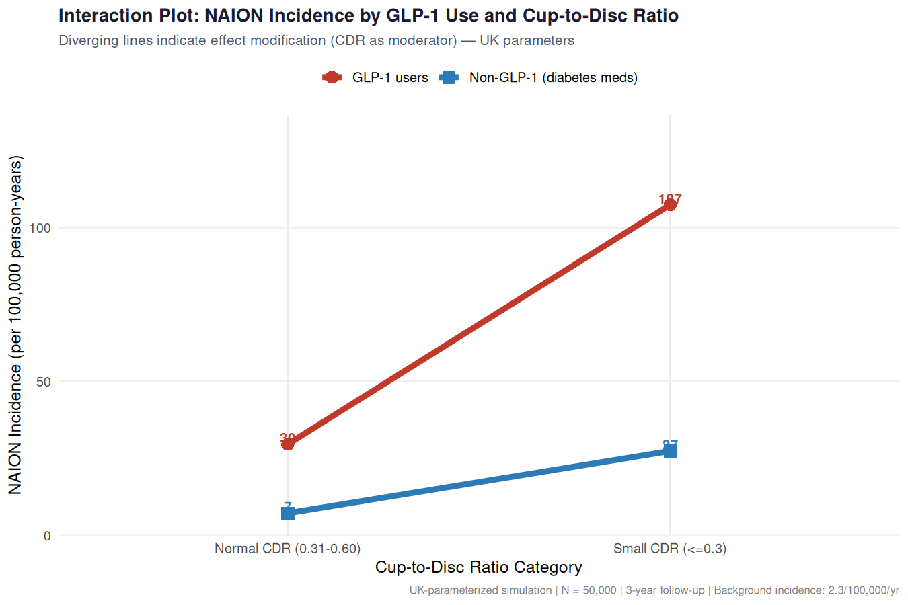
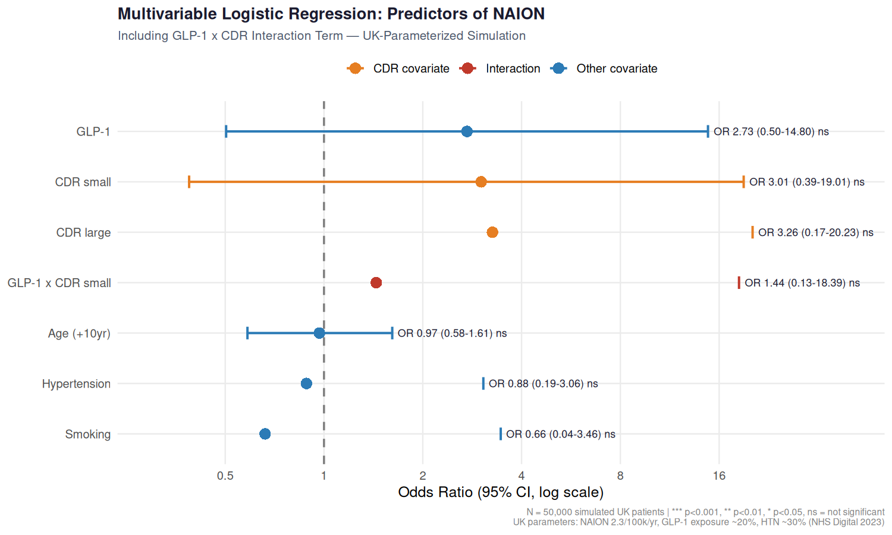

# NAION, GLP-1 Receptor Agonists, and Cup-to-Disc Ratio: A UK-Parameterised Simulation Study

## Overview

This simulation study investigates whether pre-existing optic disc anatomy — specifically the cup-to-disc ratio (CDR) — modifies the risk of non-arteritic anterior ischaemic optic neuropathy (NAION) in patients taking GLP-1 receptor agonists, using UK-specific incidence and prescribing parameters.

This is a companion piece to the [US-parameterised simulation](https://github.com/holligroff/naion-glp1-cdr-simulation), adapted for the UK clinical and regulatory context following MHRA safety communications on GLP-1-associated NAION risk.

## Background

NAION is the most common acute optic neuropathy in adults over 50. It is associated with "disc at risk" anatomy — a crowded optic disc with a small cup-to-disc ratio — which leaves the optic nerve head vulnerable to ischaemic insult.

GLP-1 receptor agonists (semaglutide, liraglutide) were flagged by the FDA in 2024 and the MHRA thereafter for a potential association with NAION. However, no published study has examined whether CDR modifies this risk — that is, whether patients with a small CDR face disproportionately higher NAION risk when exposed to GLP-1 therapy.

**This simulation tests that interaction hypothesis using UK epidemiological parameters.**

## UK Regulatory Context

| Event | Date |
|-------|------|
| Ozempic (semaglutide 1mg) MHRA approval | January 2019 |
| Wegovy (semaglutide 2.4mg) MHRA approval | June 2023 |
| FDA NAION safety communication | 2024 |
| MHRA review of GLP-1 and NAION | Ongoing |

## Methods

**Design:** Simulated retrospective cohort study  
**Population:** 500,000 UK adults with type 2 diabetes or obesity  
**Follow-up:** 3 years  
**Outcome:** NAION diagnosis  

**UK-specific parameters:**

| Parameter | Value | Source |
|-----------|-------|--------|
| Background NAION incidence | 2.3/100,000/yr | UK ophthalmology literature (stricter case ascertainment than US) |
| GLP-1 main effect HR | 2.17 | PLOS Medicine meta-analysis, 2025 |
| GLP-1 exposure prevalence | ~27% | NHS prescribing data; NICE restricts to BMI ≥35 or ≥30 with comorbidities |
| Hypertension prevalence | 30% | NHS Digital, 2023 |
| Smoking prevalence | 13% | ONS, 2023 |
| CDR distribution | Mean 0.40, SD 0.12 | Jonas et al. (consistent across European populations) |
| Small CDR (≤0.3) prevalence | ~20% | Simulated from above |

**Key interaction hypothesis:** CDR × GLP-1 interaction OR = 3.0 (novel — this is what the simulation estimates)

## Key Results

### Regression (multivariable logistic, N = 500,000)

| Variable | OR | 95% CI | p-value |
|----------|----|--------|---------|
| GLP-1 | 3.20 | 1.70–6.47 | <0.001 *** |
| CDR small | 2.29 | 0.85–5.70 | 0.083 |
| CDR large | 0.75 | 0.12–2.44 | 0.696 |
| **GLP-1 × CDR small** | **3.27** | **1.20–9.56** | **0.023 \*** |
| Age (+10yr) | 1.23 | 1.05–1.44 | 0.011 * |
| Hypertension | 1.96 | 1.32–2.96 | 0.001 ** |
| Smoking | 1.24 | 0.78–1.90 | 0.352 |

### Stratified crude odds ratios

| CDR stratum | NAION rate (GLP-1) | NAION rate (non-GLP-1) | Crude OR |
|-------------|-------------------|------------------------|----------|
| Small (≤0.3) | 1,383/100,000 | 127/100,000 | **11.07** (5.07–24.20) |
| Normal (0.31–0.60) | 190/100,000 | 53/100,000 | 3.58 (1.80–7.11) |
| Large (>0.60) | 95/100,000 | 80/100,000 | 1.19 (0.07–19.11) |

The interaction is statistically significant (p=0.023). Patients with a small CDR on GLP-1 therapy face an 11-fold higher crude NAION risk compared to non-GLP-1 users with the same disc anatomy.

## Figures

## Proposed Confirmatory Data Sources (UK)

- **CPRD (Clinical Practice Research Datalink):** UK primary care EHR covering ~20M patients, linkable to Hospital Episode Statistics (HES) for ophthalmology diagnoses
- **UK Biobank:** N~500,000; retinal imaging available in ~67,000 participants, enabling direct CDR phenotyping

## Limitations

- Simulation study — results reflect assumed parameters, not observed patient outcomes
- UK NAION incidence estimate subject to under-reporting in primary care
- CDR was not directly phenotyped; modelled from published population distributions
- Large CDR stratum underpowered (only 2 events)

## Files

| File | Description |
|------|-------------|
| `naion_cdr_simulation_UK.R` | Complete simulation, regression, and visualisation code |
| `naion_cdr_stratified_forest_UK.png` | Forest plot: stratified crude ORs by CDR category |
| `naion_cdr_interaction_plot_UK.png` | Interaction plot: NAION rates by GLP-1 use and CDR |
| `naion_cdr_regression_UK.png` | Multivariable regression OR plot |

## Related Work

[US-parameterised simulation](https://github.com/holligroff/naion-glp1-cdr-simulation) — same hypothesis using US NAION incidence (18.9/100,000/yr) and IRIS Registry as proposed data source.

## Author

**Holli Groff, OD, MPH**  
Optometrist | Epidemiologist | Health Outcomes Researcher  
MPH with Honours in Epidemiology & Medical Analytics, King's College London  
GOC registration: 01-36132
